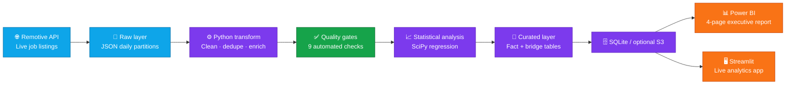
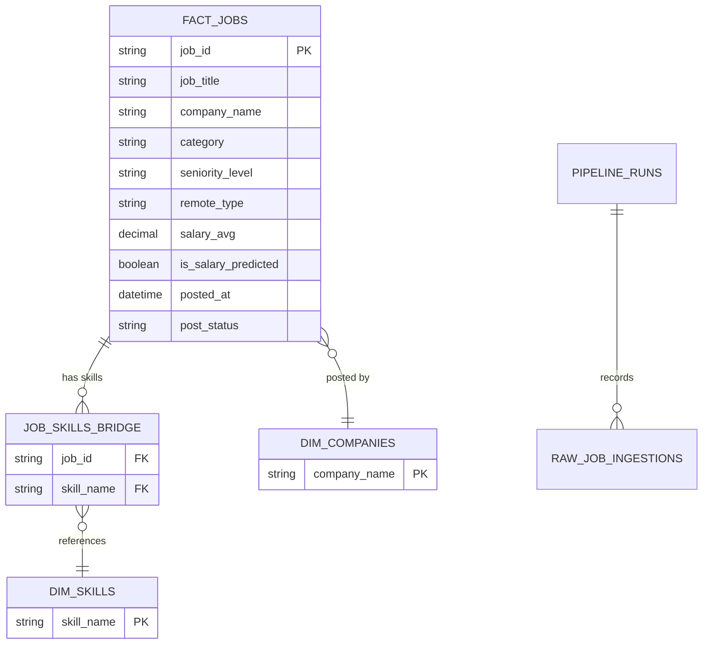

<p align="center">
  
</p>

<div align="center">


<br />

<a href="https://pipelineops-analytics-klmnopqr.streamlit.app/">
  
</a>

<br /><br />

<p>
  
  
  
  
  
</p>
<p>
  
  
  
  
</p>

<p>
  <a href="#-live-demo"><b>Live demo</b></a> ·
  <a href="#-the-story"><b>Story</b></a> ·
  <a href="#-architecture"><b>Architecture</b></a> ·
  <a href="#-dashboard-gallery"><b>Gallery</b></a> ·
  <a href="#-run-it-locally"><b>Run locally</b></a> ·
  <a href="#-data-quality--statistics"><b>Quality</b></a> ·
  <a href="#-limitations--honest-caveats"><b>Caveats</b></a>
</p>

</div>

<p align="center">
  
</p>

> **PipelineOps** turns changing job-market listings into a repeatable analytics product: **ingest → preserve → transform → validate → analyse → present.**

---

## 🔴 Live Demo

<div align="center">

### 👉 [**pipelineops-analytics-klmnopqr.streamlit.app**](https://pipelineops-analytics-klmnopqr.streamlit.app/) 👈

<a href="https://pipelineops-analytics-klmnopqr.streamlit.app/">
  
</a>

</div>

> [!TIP]
> Free Streamlit apps go to sleep when idle. If you see a "wake up" screen, click the button and give it about 30 seconds.

| Tab | What to try | Question it answers |
| --- | --- | --- |
| **Skill trends** | Compare week-over-week movers | Which skills are rising or falling? |
| **Compensation** | Filter by seniority and category | Which roles and skills pay the most? |
| **Companies** | Sort by posting volume and repost rate | Who is hiring, and who keeps reposting? |
| **Workplace mix** | Track remote / hybrid / on-site over time | How are workplace preferences shifting? |
| **Pipeline health** | Open run history and quality results | Can I trust this data? |

---

## 📖 The story

Job-market information is only useful when it is current, reliable, and easy to explore. PipelineOps collects jobs from a live source, protects the original pull in a bronze layer, builds analysis-ready tables, blocks bad data with quality gates, produces a statistical insight, and delivers it in both **Power BI** and **Streamlit**.

| ❓ Question | 🎯 Decision supported |
| --- | --- |
| Which skills are trending up or down week over week? | Prioritise learning and hiring skills. |
| Which roles and skills pay the most? | Benchmark compensation and career paths. |
| Which companies post the most jobs and how often do they repost? | Identify active employers and repeat-posting behaviour. |
| How does remote, hybrid, and on-site demand change over time? | Track workplace preference shifts. |

### 📌 Latest verified run

Snapshot from the verified project output on **22 October 2026**. Re-run the pipeline to refresh.

<div align="center">

| 💼 Unique jobs | 🏢 Companies | 🔗 Skill-job links | ✅ Quality gates | 🏆 Quality score |
| :---: | :---: | :---: | :---: | :---: |
| **172** | **26** | **901** | **9 / 9** | **100%** |

| 🐍 Python demand trend | Slope | p-value | R² |
| :---: | :---: | :---: | :---: |
| Statistically significant decline | **-0.355 listings/day** | **0.0080** | **0.316** |

</div>

<details>
<summary><strong>🛠️ What makes this an engineering project, not just a dashboard?</strong></summary>

<br />

- The raw API response is retained before any transformation.
- Stages are explicit: ingestion → transformation → validation → statistical analysis → storage.
- A run history records timing, status, records processed, and quality outcome.
- The dashboard reads the cleaned analytical layer, never the raw source.
- One curated dataset powers both the Power BI report and the Streamlit app.

</details>

---

## 🏗️ Architecture



### 🔄 The pipeline, step by step

| Stage | What happens | Key output |
| --- | --- | --- |
| **01 · Ingest** | Calls the job API with retry, backoff, logging, and failure handling. | Untouched JSON in `raw_data/` |
| **02 · Preserve** | Keeps the bronze source partitioned by ingestion date. | Reproducible source history |
| **03 · Transform** | Standardises dates, salary, workplace type, skills, company details, and repost flags. | `fact_jobs.csv` + `job_skills_bridge.csv` |
| **04 · Validate** | Checks row count, uniqueness, nulls, schema, and salary bounds. | `quality_report.json` |
| **05 · Analyse** | Runs linear regression on job demand and salary/skill relationships. | `statistical_insights.json` |
| **06 · Serve** | Writes analytical data for Power BI and Streamlit. | SQLite tables and clean CSVs |
| **07 · Orchestrate** | Supports one-off, scheduled, and Airflow DAG execution. | Run history and alert-ready logs |

---

## 🖼️ Dashboard gallery

The Power BI report is a narrative: **market pulse → skills → compensation → employers and workplace mix**. Source report: [`powerbi/PipelineOPS.pbix`](powerbi/PipelineOPS.pbix).

<table>
<tr>
<td width="50%" valign="top">

#### 01 · Executive overview


Market baseline: jobs tracked, average salary, remote share, company count, in-demand skills, and posting volume.

</td>
<td width="50%" valign="top">

#### 02 · Skill demand & growth


Week-over-week skill changes, top-five daily demand pattern, and skill concentration.

</td>
</tr>
<tr>
<td width="50%" valign="top">

#### 03 · Compensation benchmarks


Salary by seniority, best-paying skills, category and workplace comparisons, high-paying roles.

</td>
<td width="50%" valign="top">

#### 04 · Hiring cadence & remote shift


High-volume employers, reposting rate, posting cadence, and remote/hybrid/on-site mix over time.

</td>
</tr>
</table>

> [!NOTE]
> **Power BI refresh:** open the `.pbix`, then **Home → Refresh** before presenting so it uses the latest curated CSVs.

---

## 🧬 Data model



| Layer | Main asset | Why it exists |
| --- | --- | --- |
| 🥉 **Bronze** | `raw_data/` | Immutable source pulls; no transformation applied. |
| 🥈 **Silver** | `clean_data/fact_jobs.csv` | One cleaned row per job listing. |
| 🥈 **Silver** | `clean_data/job_skills_bridge.csv` | Many-to-many job-to-skill relationship for correct skill measures. |
| 🗄️ **Serving** | `clean_data/pipelineops.db` | Persistent storage for dashboards and run metadata. |
| 📊 **Presentation** | `powerbi/` and `dashboard/` | Executive reporting and self-service exploration. |

---

## 📁 Repository map

```text
pipelineops/
├── assets/                  # Dashboard screenshots + animated pipeline SVG
├── aws/                     # Optional S3/IAM deployment artefacts
├── clean_data/              # Curated CSVs, quality report, statistical insights
├── dags/                    # Airflow DAG definition
├── dashboard/               # Streamlit application
├── docs/                    # Data dictionary, insights, resume bullet
├── powerbi/                 # PipelineOPS.pbix, DAX library, dashboard blueprint
├── python/                  # Ingestion, transform, quality, storage, scheduler
├── raw_data/                # Untouched bronze API pulls
├── sql/                     # Database schema and analytical views
├── tests/                   # Automated pipeline tests
├── config.yaml              # Runtime configuration
├── requirements.txt         # Python dependencies
└── README.md                # You are here
```

---

## ⚡ Run it locally

<details open>
<summary><strong>1 · Prepare Python and configuration</strong></summary>

```powershell
git clone <your-repository-url>
cd pipelineops
py -m venv .venv
.\.venv\Scripts\Activate.ps1
pip install -r requirements.txt
Copy-Item .env.example .env
```

Edit `.env` only if you change storage, cloud, or alert settings. Keep secrets out of source control.

</details>

<details open>
<summary><strong>2 · Build the first historical dataset</strong></summary>

```powershell
python python/orchestrator.py --seed --seed-days 30
```

Produces historical trend data in addition to the live pull, then runs transform, quality, statistics, and storage.

</details>

<details>
<summary><strong>3 · Run the dashboard</strong></summary>

```powershell
streamlit run dashboard/app.py
```

</details>

<details>
<summary><strong>4 · Run checks before sharing</strong></summary>

```powershell
pytest tests/test_pipeline.py -v
```

</details>

<details>
<summary><strong>5 · Schedule it</strong></summary>

```powershell
python python/scheduler.py --run-once                      # run once now
python python/scheduler.py --interval-hours 24             # refresh daily
python python/scheduler.py --interval-seconds 60           # quick local test
```

</details>

<details>
<summary><strong>Useful run variants</strong></summary>

```powershell
python python/orchestrator.py --no-live                    # reprocess existing raw partitions
python python/orchestrator.py --seed --seed-days 60        # more historical seed data
```

</details>

---

## 🛡️ Data quality & statistics

### Automated quality gates

The pipeline does not silently hand bad data to the dashboard.

| Gate | Protection |
| --- | --- |
| Row-count threshold | Detects unexpectedly small pulls. |
| Primary-key uniqueness | Prevents duplicate job IDs. |
| Required-field null checks | Requires job ID, title, company, posted date, and workplace type. |
| Schema validation | Detects missing or unexpected structural changes. |
| Salary-range validation | Flags compensation outside configured realistic bounds. |

### Statistical insight

The analysis uses `scipy.stats.linregress` instead of reading a trend off a chart. The latest verified output shows a **downward Python-listing trend of 0.355 listings/day** (**p = 0.0080**, **R² = 0.316**), presented as a qualified, reproducible finding, not a causal conclusion.

---

## ⚠️ Limitations & honest caveats

- **Single source:** data comes from one job API, so it reflects that board's listings, not the whole market.
- **Small sample:** 172 listings across 26 companies is enough for a demonstration, not for market-wide claims.
- **Short window:** the trend regression uses a limited date range; treat it as indicative and re-run as history grows.
- **Correlation, not causation:** a falling Python listing count does not mean Python demand is falling market-wide.
- **Predicted salaries:** rows flagged `is_salary_predicted` are estimates, not posted figures.

---

## 🧭 Analytics experiences

| Experience | Best for | Location |
| --- | --- | --- |
| 📊 **Power BI** | Executive storytelling and presentation-ready reporting | [`powerbi/PipelineOPS.pbix`](powerbi/PipelineOPS.pbix) |
| 🖥️ **Streamlit (live)** | Interactive investigation and pipeline health | [Open the live dashboard](https://pipelineops-analytics-klmnopqr.streamlit.app/) · [`dashboard/app.py`](dashboard/app.py) |
| 📘 **Data dictionary** | Field definitions and engineered columns | [`docs/data_dictionary.md`](docs/data_dictionary.md) |
| 🧮 **DAX library** | Rebuilding or reviewing Power BI measures | [`powerbi/dax_measures.dax`](powerbi/dax_measures.dax) |
| 🗺️ **Dashboard blueprint** | Visual-by-visual build specification | [`powerbi/dashboard_blueprint.md`](powerbi/dashboard_blueprint.md) |

---

## ⚙️ Configuration, storage & deployment

- **API:** Remotive job API, configured in `config.yaml`.
- **Storage:** SQLite by default; the storage layer can use a configured database connection.
- **Cloud:** optional S3 support in `python/s3_uploader.py`, with assets in `aws/`.
- **Orchestration:** lightweight local scheduler or the Airflow DAG in `dags/`.
- **Observability:** runs, record counts, duration, stage status, and quality result are persisted.
- **Alerts:** configuration-driven; add approved email or webhook settings before enabling.
- **Hosting:** the Streamlit app is deployed on [Streamlit Community Cloud](https://pipelineops-analytics-klmnopqr.streamlit.app/).

---

## 📚 Project documentation

| Document | What it helps you explain |
| --- | --- |
| [`docs/insights.md`](docs/insights.md) | Numbers-first findings from the current dataset. |
| [`docs/data_dictionary.md`](docs/data_dictionary.md) | How raw and engineered fields should be interpreted. |
| [`docs/resume_bullet.md`](docs/resume_bullet.md) | A concise resume-ready project statement. |
| [`sql/schema.sql`](sql/schema.sql) | Relational design, keys, and storage schema. |
| [`dags/pipelineops_dag.py`](dags/pipelineops_dag.py) | Airflow orchestration design. |

---

<div align="center">

### Built to make a changing job market explainable.

**PipelineOps = reliable ingestion + traceable data quality + honest analysis + clear decisions.**

<a href="https://pipelineops-analytics-klmnopqr.streamlit.app/">
  
</a>

<sub>Refresh the pipeline. Refresh Power BI. Tell the next market story.</sub>

</div>

<p align="center">
  
</p>
