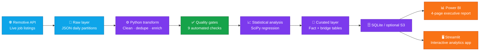
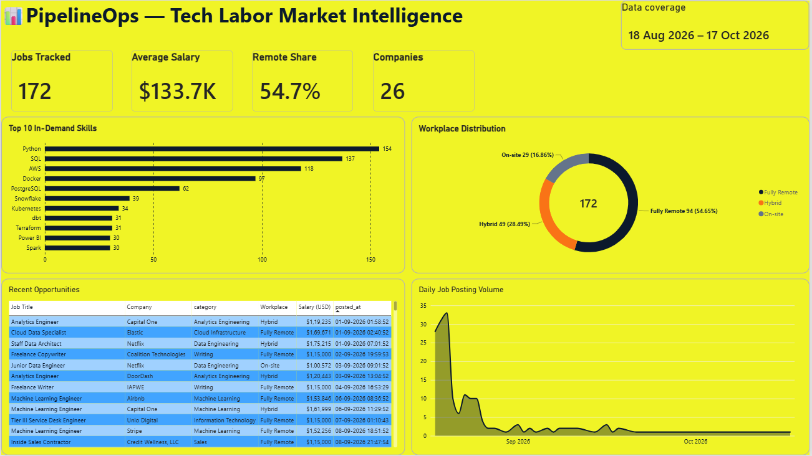
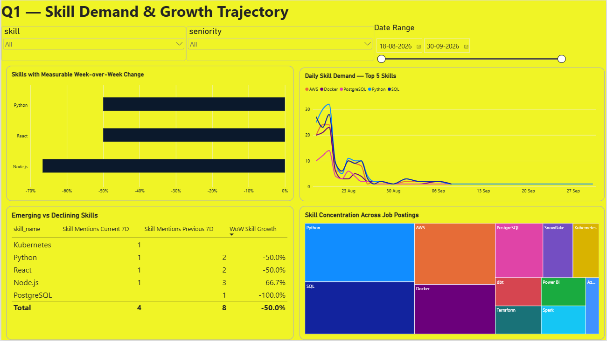
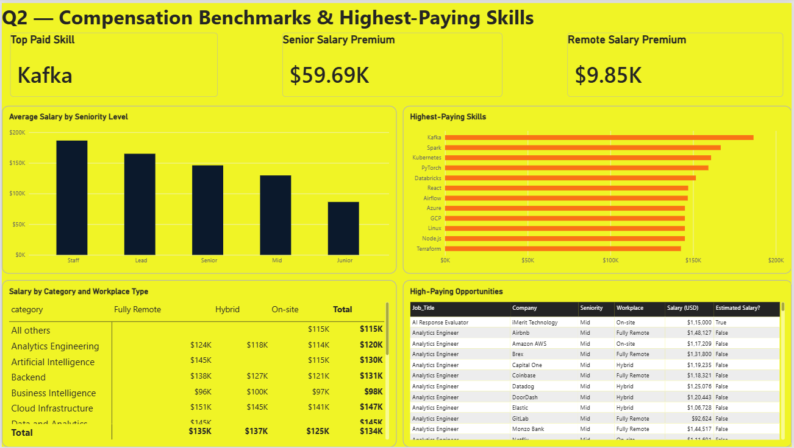
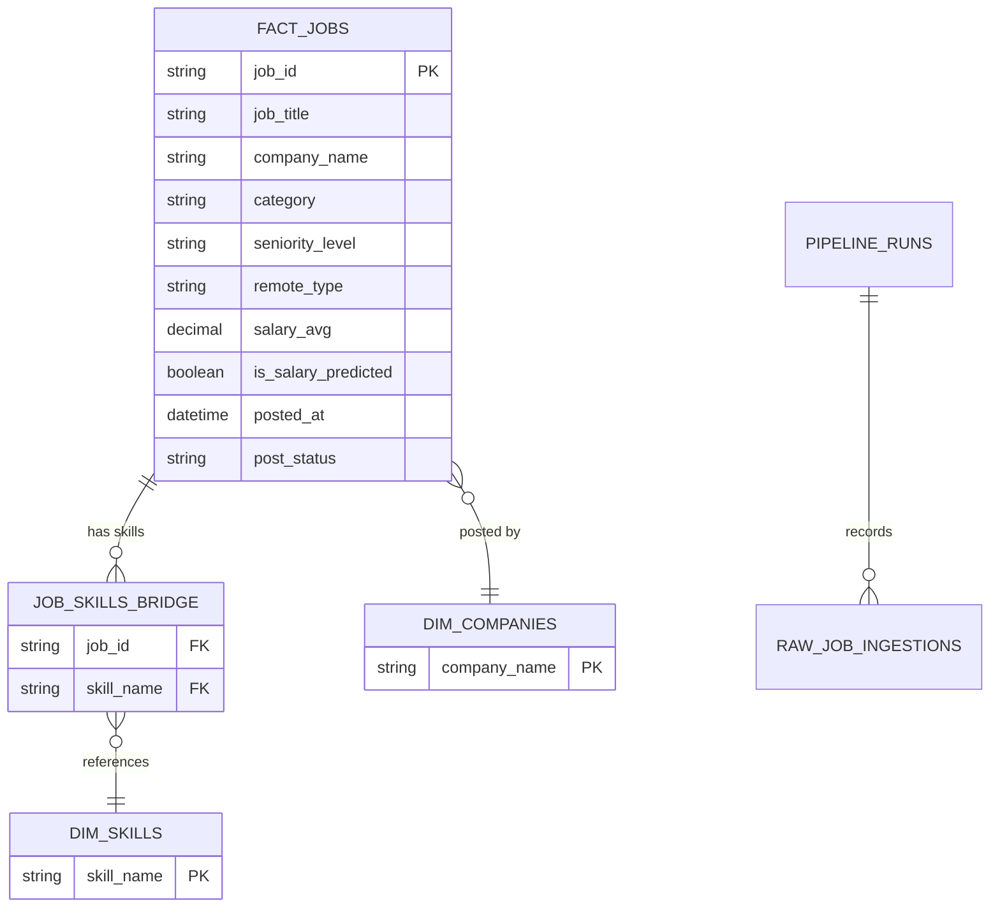

<p align="center">
  
</p>

<div align="center">

# PipelineOps

### Tech Labor Market Intelligence — from live API data to decision-ready analytics


<p>
  
  
  
  
</p>

<a href="https://pipelineops-analytics-klmnopqr.streamlit.app/">
  
</a>

<p>
  <a href="#the-story">The story</a> ·
  <a href="#architecture">Architecture</a> ·
  <a href="#dashboard-gallery">Dashboard gallery</a> ·
  <a href="#run-it-locally">Run locally</a> ·
  <a href="#data-quality--statistics">Quality & statistics</a>
</p>

> **PipelineOps** turns changing job-market listings into a repeatable analytics product: ingest, preserve, transform, validate, analyse, and present.

</div>

---

## The story

Job-market information is only useful when it is current, reliable, and easy to explore. PipelineOps is an end-to-end analytics project built around that idea. It collects jobs from a live source, protects the original pull in a bronze layer, creates analysis-ready tables, stops bad data with quality gates, produces a statistical insight, and delivers the results in both **Power BI** and **Streamlit**.

The project answers four practical questions:

| Question | Decision supported |
| --- | --- |
| Which skills are trending up or down week over week? | Prioritise learning and hiring skills. |
| Which roles and skills pay the most? | Benchmark compensation and career paths. |
| Which companies post the most jobs and how often do they repost? | Identify active employers and repeat-posting behaviour. |
| How does remote, hybrid, and on-site demand change over time? | Track workplace preference shifts. |

### Latest verified run

The values below are a transparent snapshot from the verified project output on **22 October 2026**. Run the pipeline again to refresh the figures.

| Metric | Verified result |
| --- | ---: |
| Unique job listings | 172 |
| Companies represented | 26 |
| Skill-to-job records | 901 |
| Data-quality gates | 9 / 9 passed |
| Quality score | 100% |
| Python demand trend | -0.355 listings/day, statistically significant (p = 0.0080) |

<details>
<summary><strong>What makes this an engineering project, not just a dashboard?</strong></summary>

<br />

- The raw API response is retained before transformations occur.
- Pipeline stages are explicit: ingestion → transformation → validation → statistical analysis → storage.
- A run history records timing, status, records processed, and quality outcome.
- The dashboard reads the cleaned analytical layer, never the raw source.
- The same curated data supports a portfolio-ready Power BI report and an interactive Streamlit application.

</details>

---

## Architecture



### The pipeline, step by step

| Stage | What happens | Key output |
| --- | --- | --- |
| **01 · Ingest** | Calls the job API with retry, backoff, logging, and failure handling. | Untouched JSON in `raw_data/` |
| **02 · Preserve** | Keeps the bronze source partitioned by ingestion date. | Reproducible source history |
| **03 · Transform** | Standardises dates, salary, workplace type, skills, company details, and repost flags. | `fact_jobs.csv` + `job_skills_bridge.csv` |
| **04 · Validate** | Checks row count, uniqueness, nulls, expected schema, and salary bounds. | `quality_report.json` |
| **05 · Analyse** | Runs linear-regression analysis for job demand and salary/skill relationships. | `statistical_insights.json` |
| **06 · Serve** | Writes analytical data for Power BI and Streamlit consumption. | SQLite tables and clean CSVs |
| **07 · Orchestrate** | Supports one-off, scheduled, and Airflow DAG execution. | Run history and alert-ready logs |

---

## Dashboard gallery

The Power BI report is deliberately structured as a narrative: **market pulse → skills → compensation → employers and workplace mix**. Open the source report at [`powerbi/PipelineOPS.pbix`](powerbi/PipelineOPS.pbix).

### 01 — Executive overview

<p align="center">
  
</p>

**Purpose:** Establish the market baseline with jobs tracked, average salary, remote share, company count, in-demand skills, workplace distribution, recent opportunities, and posting volume.

### 02 — Skill demand & growth trajectory

<p align="center">
  
</p>

**Purpose:** Compare measurable week-over-week skill changes, investigate the top-five daily demand pattern, and understand skill concentration across job postings.

### 03 — Compensation benchmarks & highest-paying skills

<p align="center">
  
</p>

**Purpose:** Benchmark salary by seniority, reveal the best-paying skills, compare compensation by category and workplace type, and inspect high-paying opportunities.

### 04 — Company hiring cadence & remote-work shift

<p align="center">
  
</p>

**Purpose:** Identify high-volume hiring companies, quantify reposting, assess posting cadence, and track remote/hybrid/on-site mix over time.

> **Power BI refresh note:** Open the `.pbix` file and select **Home → Refresh** before presenting, so the report uses the latest curated CSV data rather than an older cached snapshot.

---

## Data model



| Layer | Main asset | Why it exists |
| --- | --- | --- |
| **Bronze** | `raw_data/` | Immutable source pulls; no transformation is applied. |
| **Silver** | `clean_data/fact_jobs.csv` | One cleaned, analysis-ready row per job listing. |
| **Silver** | `clean_data/job_skills_bridge.csv` | Many-to-many job-to-skill relationship for correct skill measures. |
| **Serving** | `clean_data/pipelineops.db` / database tables | Persistent storage for the dashboard and run metadata. |
| **Presentation** | `powerbi/` and `dashboard/` | Executive reporting and exploratory self-service analytics. |

---

## Repository map

```text
pipelineops/
├── assets/                  # Power BI dashboard screenshots used above
├── aws/                     # Optional S3/IAM deployment artefacts
├── clean_data/              # Curated CSVs, quality report, statistical insights
├── dags/                    # Airflow DAG definition
├── dashboard/               # Streamlit application
├── docs/                    # Data dictionary, insights, and resume bullet
├── powerbi/                 # PipelineOPS.pbix, DAX library, dashboard blueprint
├── python/                  # Ingestion, transform, quality, storage, scheduler
├── raw_data/                # Untouched bronze API pulls
├── sql/                     # Database schema and analytical views
├── tests/                   # Automated pipeline tests
├── config.yaml              # Runtime configuration
├── requirements.txt         # Python dependencies
└── README.md                # You are here
```

---

## Run it locally

### 1. Prepare Python and configuration

```powershell
git clone <your-repository-url>
cd pipelineops
py -m venv .venv
.\.venv\Scripts\Activate.ps1
pip install -r requirements.txt
Copy-Item .env.example .env
```

Update `.env` only if you are changing storage, cloud, or alert settings. Keep secrets out of source control.

### 2. Build the first historical dataset

```powershell
python python/orchestrator.py --seed --seed-days 30
```

This produces historical trend data in addition to the live pull, then runs transform, quality, statistics, and storage stages.

### 3. Run the dashboard

```powershell
streamlit run dashboard/app.py
```

### 4. Run checks before sharing

```powershell
pytest tests/test_pipeline.py -v
```

### 5. Schedule it

```powershell
# Run once now
python python/scheduler.py --run-once

# Refresh every 24 hours
python python/scheduler.py --interval-hours 24

# Quick local scheduler test
python python/scheduler.py --interval-seconds 60
```

<details>
<summary><strong>Useful run variants</strong></summary>

<br />

```powershell
# Process existing raw partitions without a live API request
python python/orchestrator.py --no-live

# Generate a different amount of historical seed data
python python/orchestrator.py --seed --seed-days 60
```

</details>

---

## Data quality & statistics

### Automated quality gates

The pipeline does not silently hand bad data to the dashboard. It checks:

| Gate | Protection |
| --- | --- |
| Row-count threshold | Detects unexpectedly small pulls. |
| Primary-key uniqueness | Prevents duplicate job IDs. |
| Required-field null checks | Requires job ID, title, company, posted date, and workplace type. |
| Schema validation | Detects missing or unexpected structural changes. |
| Salary-range validation | Flags compensation outside the configured realistic bounds. |

### Statistical insight

The analysis uses `scipy.stats.linregress` rather than claiming a trend from a chart alone. The latest verified output found a **downward Python-listing trend of 0.355 listings per day** with **p = 0.0080** and **R² = 0.316**. This is displayed as a qualified, reproducible finding; it is not presented as a causal conclusion.

---

## Analytics experiences

| Experience | Best for | Location |
| --- | --- | --- |
| **Power BI** | Structured executive storytelling, filters, and presentation-ready reporting. | [`powerbi/PipelineOPS.pbix`](powerbi/PipelineOPS.pbix) |
| **Streamlit** | Interactive investigation across Q1–Q4 plus pipeline health. | [Open the live dashboard](https://pipelineops-analytics-klmnopqr.streamlit.app/) · [`dashboard/app.py`](dashboard/app.py) |
| **Data dictionary** | Field definitions and engineered-column transparency. | [`docs/data_dictionary.md`](docs/data_dictionary.md) |
| **DAX measure library** | Rebuilding or reviewing Power BI calculations. | [`powerbi/dax_measures.dax`](powerbi/dax_measures.dax) |
| **Dashboard blueprint** | Visual-by-visual Power BI build specification. | [`powerbi/dashboard_blueprint.md`](powerbi/dashboard_blueprint.md) |

---

## Configuration, storage & deployment

- **API:** Remotive job API, configured in `config.yaml`.
- **Storage:** SQLite is the local default; the storage layer can use a configured database connection.
- **Cloud:** S3 support is optional and isolated in `python/s3_uploader.py` with related assets in `aws/`.
- **Orchestration:** Use the lightweight scheduler locally or the Airflow DAG in `dags/` for managed scheduling.
- **Observability:** Pipeline runs, record counts, duration, stage status, and quality result are persisted for review.
- **Alerts:** Failure alerting is configuration-driven; add your approved email or webhook settings before enabling external notifications.

---

## Project documentation

| Document | What it helps you explain in a review or interview |
| --- | --- |
| [`docs/insights.md`](docs/insights.md) | Numbers-first findings from the current analytical dataset. |
| [`docs/data_dictionary.md`](docs/data_dictionary.md) | How raw and engineered fields should be interpreted. |
| [`docs/resume_bullet.md`](docs/resume_bullet.md) | A concise resume-ready project statement. |
| [`sql/schema.sql`](sql/schema.sql) | Relational design, keys, and storage schema. |
| [`dags/pipelineops_dag.py`](dags/pipelineops_dag.py) | Airflow orchestration design. |

---

<div align="center">

### Built to make a changing job market explainable.

**PipelineOps = reliable ingestion + traceable data quality + honest analysis + clear decisions.**

<sub>Refresh the pipeline. Refresh Power BI. Tell the next market story.</sub>

</div>

<p align="center">
  
</p>
